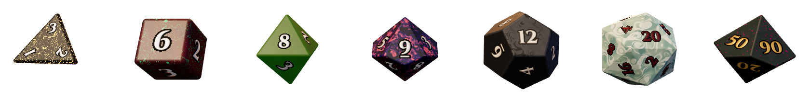
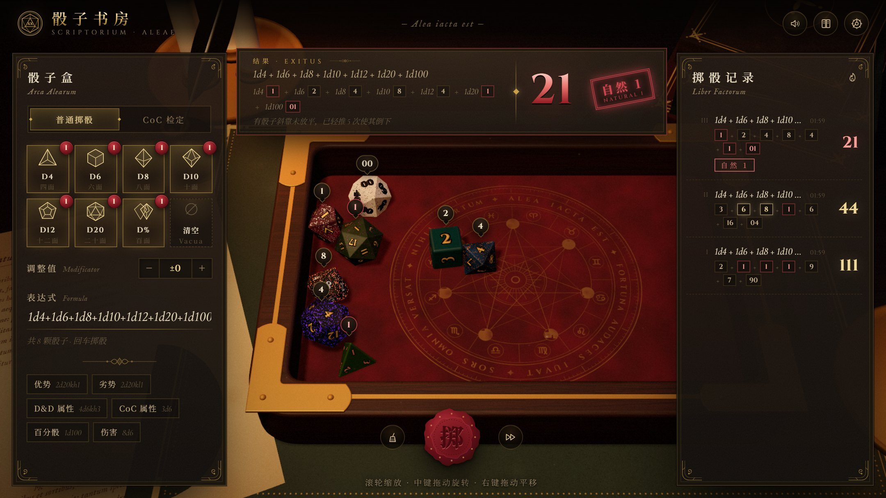

<div align="center">



# ScriptoriumAleae · 骰子书房

在浏览器里用物理模拟掷骰子。

**[在线使用 →](https://fftyyy.github.io/ScriptoriumAleae/)**

中文 · [English](README.en.md)

</div>



## 这是什么

一张放在书房里的 3D 骰盘。骰子是真的被“掷”出去的：它们在盘里翻滚、互相碰撞、慢慢停下，朝上的那一面就是结果。没有动画剧本，也不预先决定点数。

支持 d4、d6、d8、d10、d12、d20 和百分骰（十位骰 + 个位骰），也内置了 D&D 常用的表达式写法和《克苏鲁的呼唤》检定。

## 特点

- **真实物理**：刚体模拟。每颗骰子按均匀密度计算质量和转动惯量，质心在正中，没有“灌铅”；出手时的位置、速度和旋转来自浏览器的密码学随机数。
- **每颗骰子都不一样**：配色、花纹和材质由程序当场生成，有树脂、宝石、星云、磨砂金属、珍珠等。数字颜色按对比度自动挑选，保证看得清；也可以换成固定样式。
- **两种掷法**：点按钮直接掷；或者在桌面上按住，拖动摇一摇再甩出去，力度和方向跟着你的手势。
- **表达式**：`3d6 + 2`、`2d20kh1`（优势）、`4d6dl1`（去掉最低）、`1d100` 等。
- **CoC 检定**：输入技能值，自动判定大成功、极难、困难、成功、失败、大失败；奖励骰和惩罚骰会真的多掷一颗十位骰。
- **可以细看**：骰子停下后镜头会自动靠近；滚轮缩放，中键拖动旋转，右键拖动平移。
- **中英双语**：右上角切换，英文界面的地址是 [`?lang=en`](https://fftyyy.github.io/ScriptoriumAleae/?lang=en)。
- 默认 0.35 倍速慢放，能看清翻滚，也可以切到真实速度；另有碰撞音效、掷骰记录，手机上也能用。

## 本地运行

需要 Node.js 22 或以上。

```bash
npm install
npm run dev
```

`npm run build` 会构建出一个纯静态网站（`dist/`）。推送到 `main` 分支后，GitHub Actions 会自动把它发布到 GitHub Pages。

## 技术

TypeScript、React、three.js、cannon-es、Vite。场景里的木纹、毛毡、皮革、羊皮纸，以及骰子的花纹和数字，全部由代码生成，没有用到图片素材。

## 许可

[MIT](LICENSE)
